

  <picture>
    <source media="(prefers-color-scheme: dark)" srcset="banner-oscuro.svg">
    
  </picture>

  

**Haz una foto a una carta, una multa o una notificación, y Gestorín te dice en sencillo qué es, cuánto
pagas y hasta cuándo.** Te avisa antes de cada plazo para que no se te pase. Es gratis, para Windows y
Android, y tus papeles se quedan en tu móvil o tu ordenador, cerrados con una frase que solo sabes tú.

## Así se usa, en un minuto

<table>
  <tr>
    <td width="33%" align="center">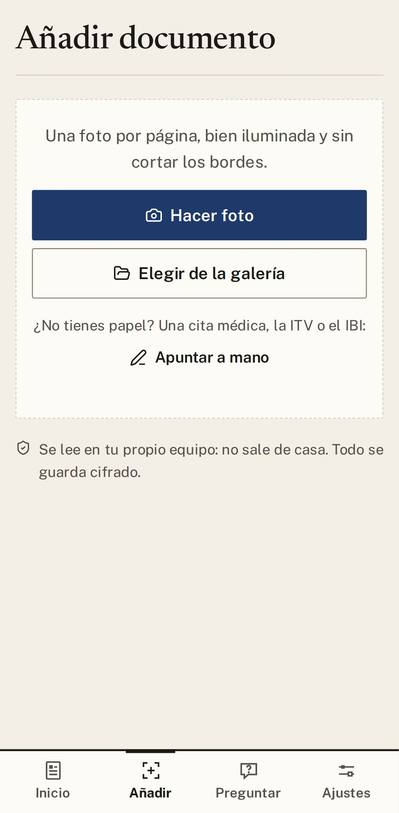</td>
    <td width="33%" align="center">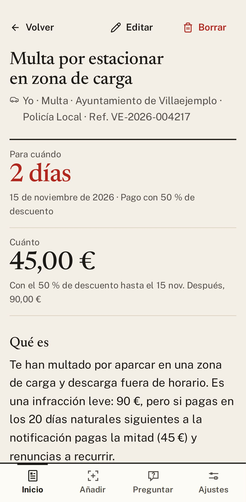</td>
    <td width="33%" align="center">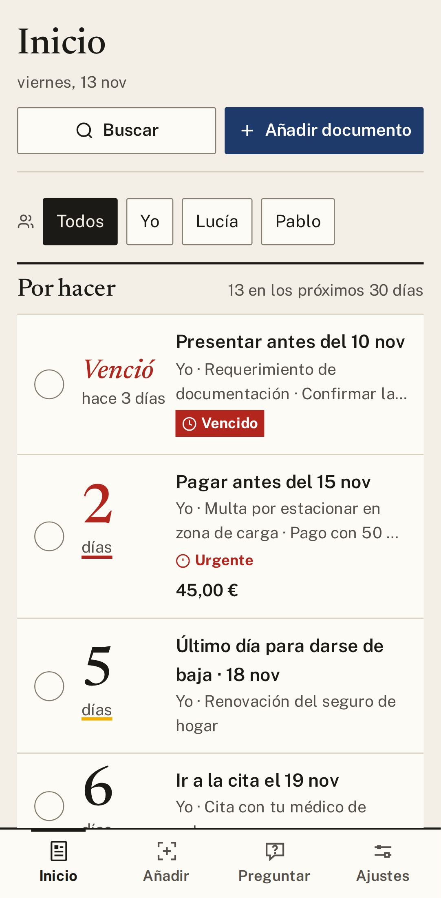</td>
  </tr>
  <tr>
    <td align="center"><b>1. Añade la carta</b> Una foto, un PDF o un correo.</td>
    <td align="center"><b>2. Léela en sencillo</b> Qué es, cuánto y para cuándo.</td>
    <td align="center"><b>3. Lo urgente, arriba</b> Te avisa y lo marcas como hecho.</td>
  </tr>
</table>

## Para empezar con la app

1. La app para Windows y Android aún no tiene descarga pública: mientras, **pruébala sin instalar** con
   el botón de arriba.
2. Ábrela y elige una **frase que solo sepas tú**: es la llave de tus papeles. Apúntala en papel.
3. Elige **quién lee tus cartas** (lo ves justo aquí debajo). Se puede cambiar cuando quieras.

### Quién lee tus cartas

| | Cómo es | Cuesta |
|---|---|---|
| **Gratis, en tu ordenador** (recomendado) | Hay que instalar **una vez** un programa gratuito en un ordenador de casa (pide ayuda si hace falta). Desde entonces, tus cartas se leen en casa y no salen de ella. | Nada |
| **Sin inteligencia artificial** | Para quien solo tiene el móvil: saca fechas, importes y referencias en el propio móvil, sin instalar nada, pero no te explica la carta. | Nada |
| **Claude** | El que mejor acierta. La carta se envía por internet a Anthropic, la empresa de Claude, y se procesa fuera de la Unión Europea; según sus condiciones, no la usa para entrenar a su IA. Necesitas una cuenta de pago en su web. | Unos céntimos por carta |

Antes de que un documento salga de casa, Gestorín **siempre te pregunta**.

  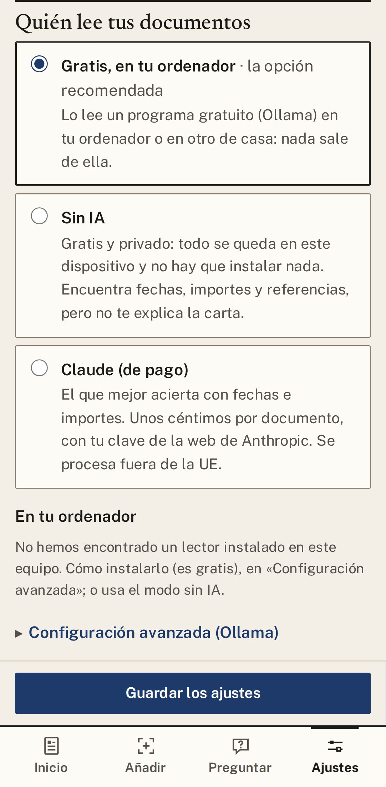

## Paso a paso

### Añadir un documento

Pulsa **Añadir documento** y haz una foto (o elige una de la galería, un PDF o un correo guardado).
Gestorín encuentra la hoja, la recorta y la endereza; si la carta tiene varias páginas, añádelas antes
de pulsar **Leer**. ¿No hay papel, como una cita del médico? **Apúntalo a mano**.

  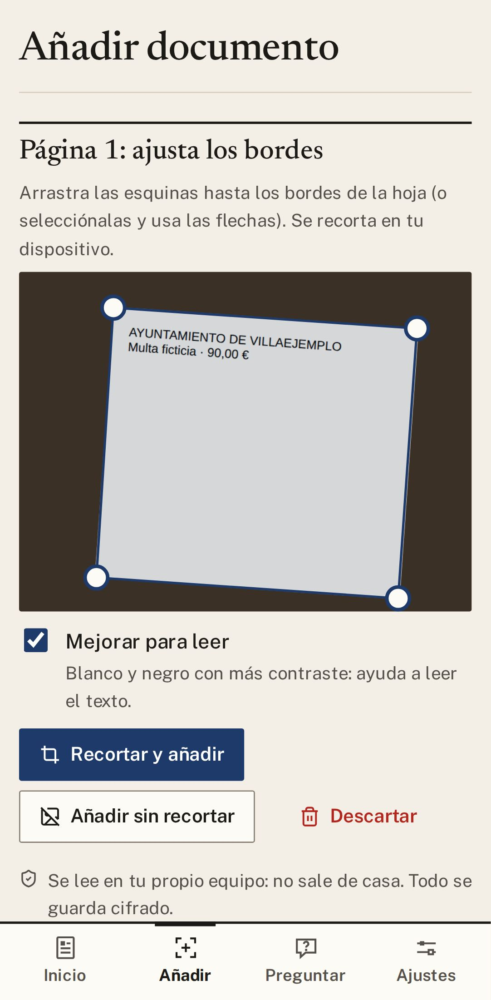
  &nbsp;
  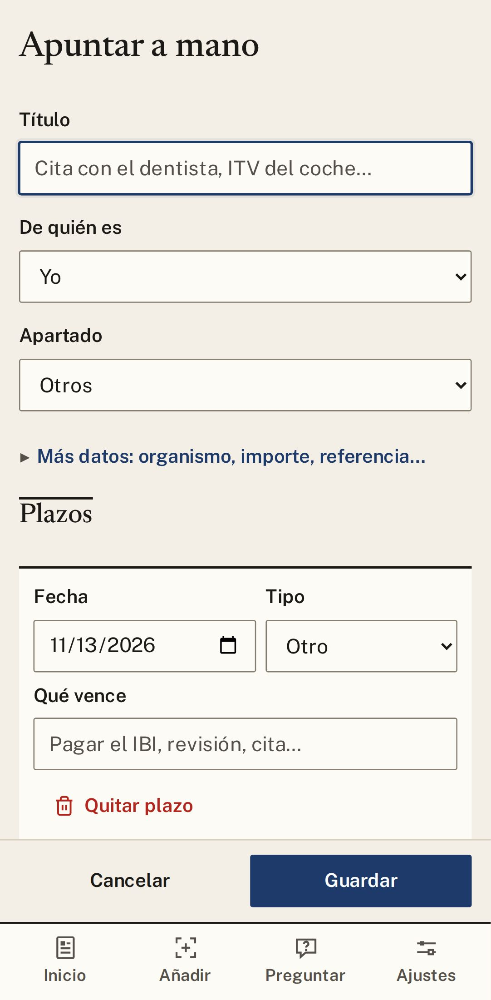

### La ficha: tu carta, explicada

Arriba, en grande, **para cuándo** y **cuánto** (lo ves en la captura del paso 2). Debajo, **qué es** con
palabras normales y **qué tienes que hacer**, paso a paso. Al final, sus plazos: cada uno con **Marcar
hecho**, **Al calendario** y una línea que te dice cuándo te avisaremos.

  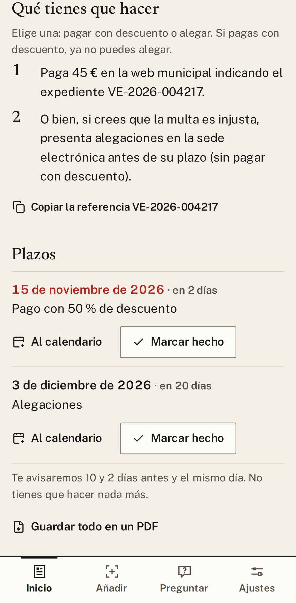

### «Por hacer» y los avisos

Inicio es tu lista de tareas: lo que vence en los próximos 30 días, **lo más urgente arriba** (en rojo
lo que vence ya). Toca el círculo cuando lo hagas; si te equivocas, **Deshacer**. Los carnets que
caducan pronto también salen aquí. Te avisamos a las 9 de la mañana unos días antes y el mismo día.

  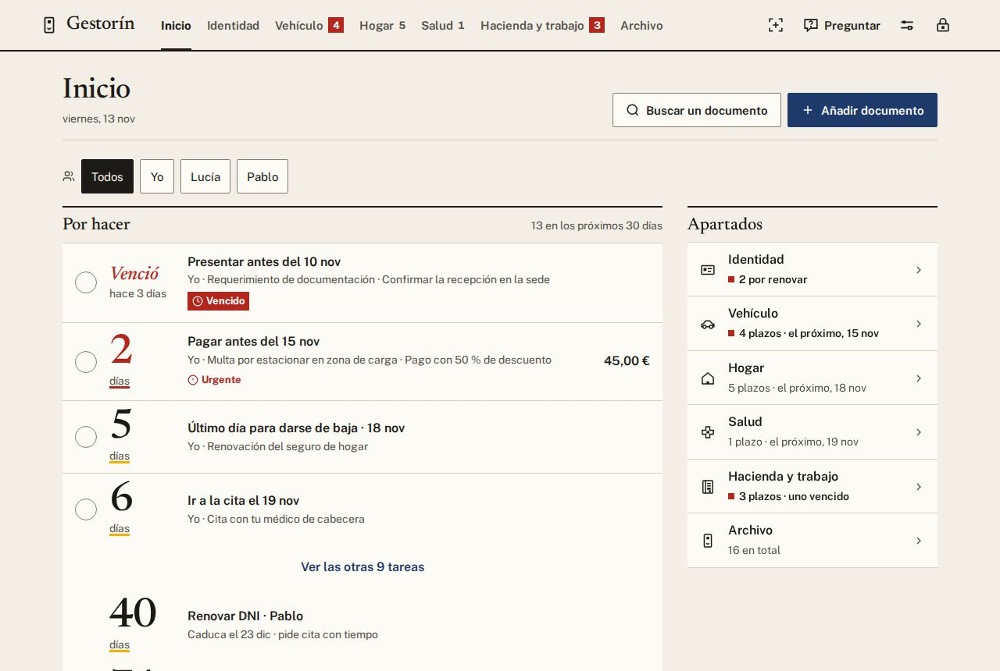

### Tus apartados

| | |
|---|---|
| **Identidad** | Tu DNI, el carnet de conducir, el pasaporte y la tarjeta sanitaria, con aviso antes de que caduquen y el botón **Pedir cita para renovar** (la cita es gratuita). |
| **Vehículo** | Multas, ITV, seguro e impuesto de circulación, con el enlace a la web de la DGT. |
| **Hogar** | Alquiler o hipoteca, luz y agua, seguros, IBI, comunidad y garantías. |
| **Salud** | Citas, recetas e informes, y la app oficial de tu comunidad. |
| **Hacienda y trabajo** | Cartas de Hacienda, la renta, la vida laboral, el calendario del año y el resumen de gastos. |
| **Archivo** | Todo lo que guardas, con buscador. |

  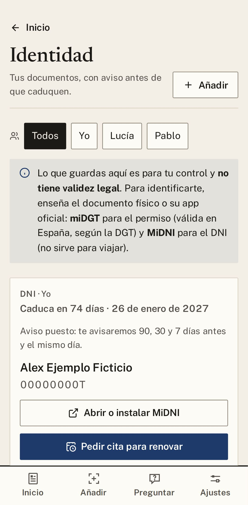
  &nbsp;
  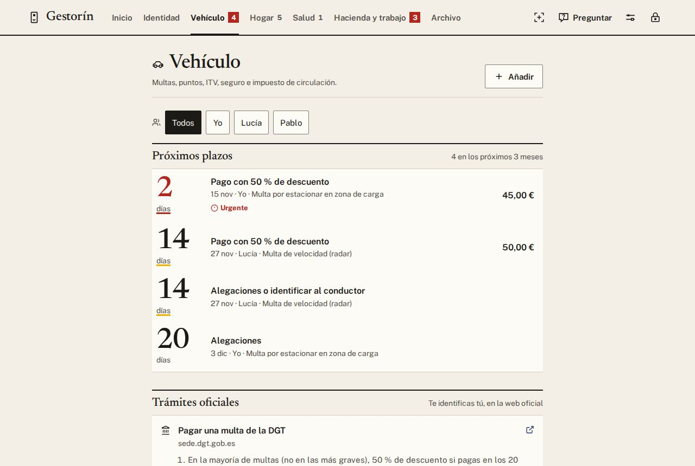

  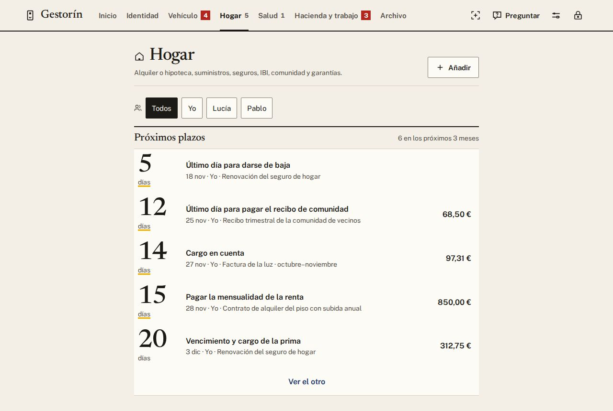
  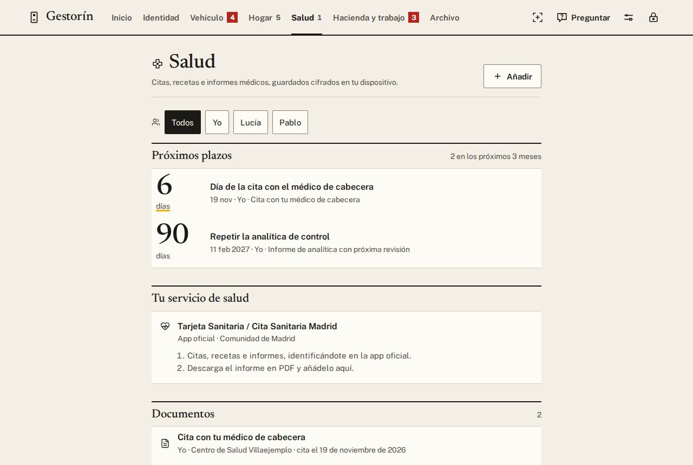

### Multas: pagar o reclamar

La ficha de una multa te dice si puedes **pagar la mitad** y hasta cuándo, y te lleva a la **web oficial**
para pagarla o reclamar. **Ojo: es una cosa o la otra.** Si pagas con descuento, ya no puedes reclamar;
si reclamas, pierdes el descuento. Para reclamar, Gestorín te prepara **un escrito ya redactado
(alegaciones)** con los datos de la multa: es un borrador, no asesoramiento legal; revísalo o consulta a
un abogado. En las de zona azul o aparcamiento regulado te recuerda que en muchas ciudades se anulan el
mismo día pagando poco.

  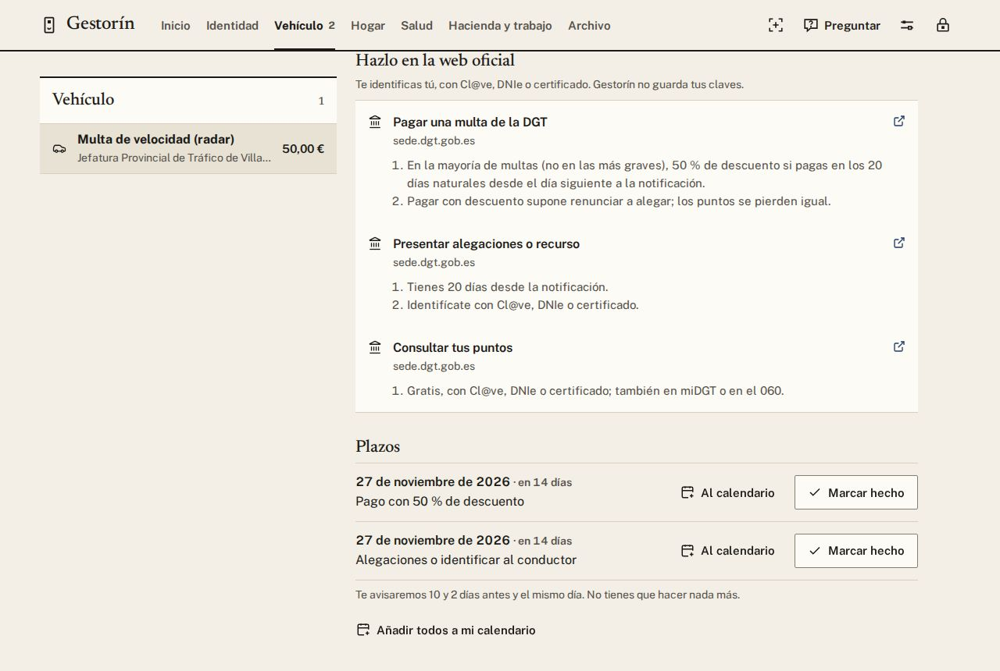
  &nbsp;
  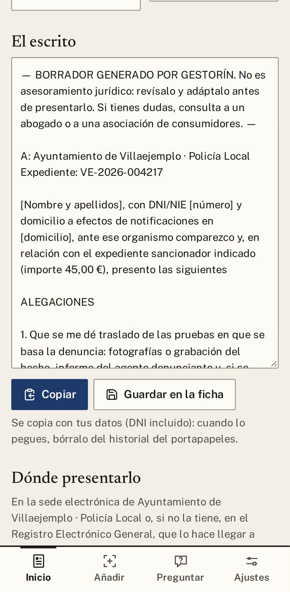

### Para toda la familia

Lleva también los papeles de tu pareja, tus hijos o tus padres, y filtra por persona con un toque.

  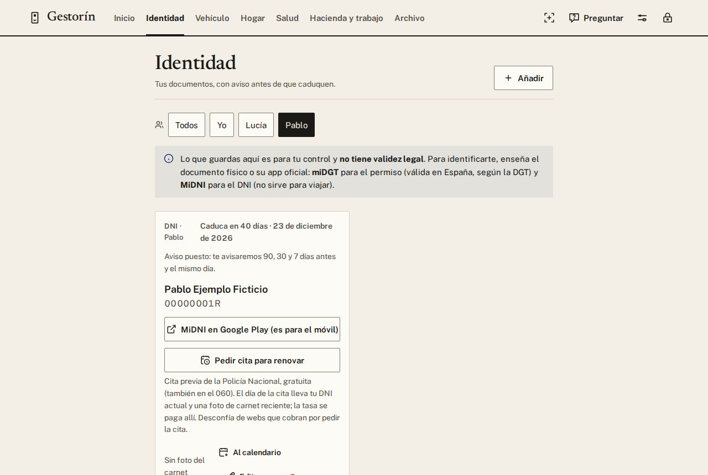

### El año de un vistazo: calendario y gastos

En **Hacienda y trabajo**, activa la renta, el IBI, el impuesto de circulación o la ITV, y Gestorín te
avisa cada año. Debajo, el **resumen de gastos**: cuánto suman este año tus recibos de seguros,
impuestos, multas, luz y agua… Toca un tipo para ver sus recibos.

  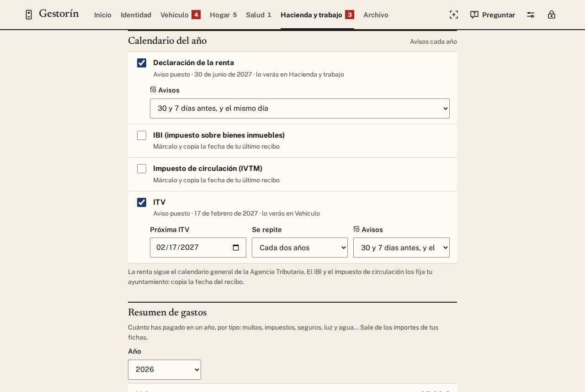
  &nbsp;
  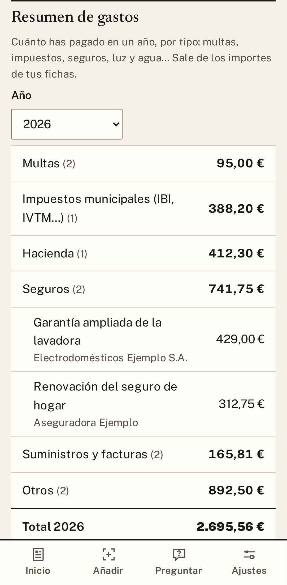

### Buscar, preguntar y guardar en PDF

**Buscar un documento** (arriba, en Inicio y en Archivo) lo encuentra aunque lo llames de otra forma:
si buscas «contribución», encuentra el IBI. **Preguntar** te contesta como hablas: «¿cuánto pagué de IBI?». Y desde cada
ficha, **Guardar todo en un PDF** junta la explicación, los plazos y la carta original, para imprimir o
enviar a tu gestor.

  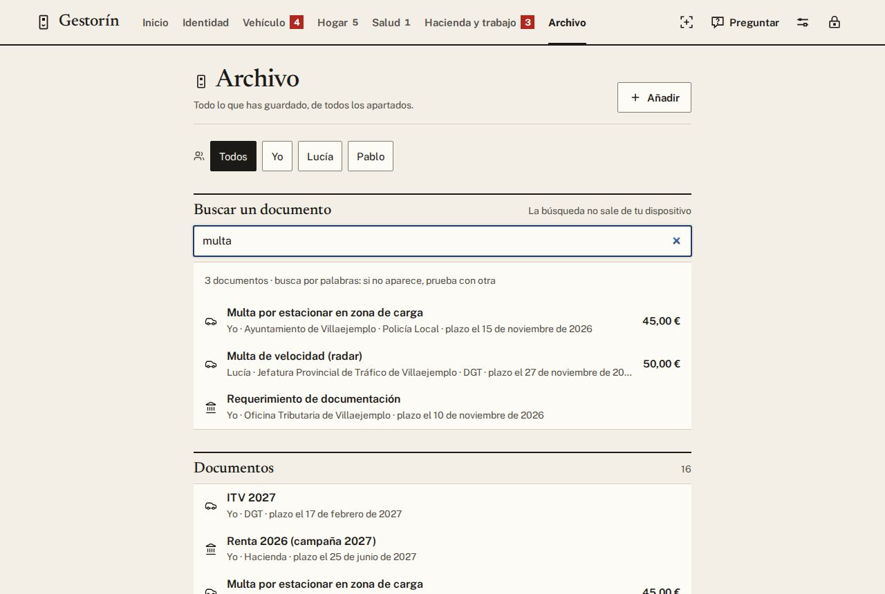
  &nbsp;
  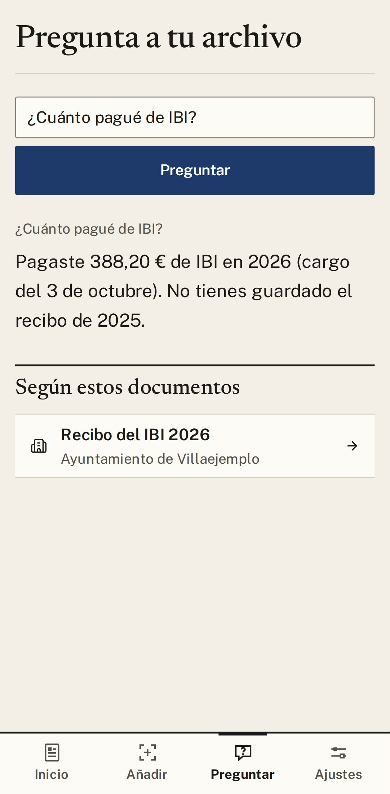

### Copia de seguridad

En **Ajustes → Copia de seguridad** guardas todo en un solo archivo cerrado con una contraseña tuya.
Sirve para no perder nada y para llevarlo a otro móvil u ordenador.

  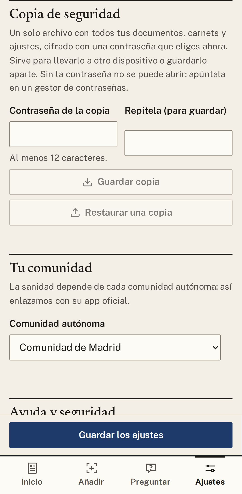

## Lo que Gestorín no hace

- **No sustituye a tus documentos.** Para identificarte en España vale el DNI físico o la app oficial **MiDNI** (que no sirve para viajar), y para conducir, **miDGT**. Gestorín las abre con un toque.
- Las fotos de tus carnets en Gestorín **no tienen validez legal**: son solo para tu control.
- **No entra en la DGT ni en Hacienda por ti**: te lleva a la web oficial, te identificas tú y guardas el justificante.
- **Nunca te pide tus claves de la Administración** (Cl@ve, el PIN del DNI o el certificado digital).

## Preguntas frecuentes

**¿Cuánto cuesta?**
Nada. Solo pagas si eliges Claude, y se lo pagas directamente a Anthropic.

**¿Me avisa aunque no tenga la app abierta?**
En el móvil, sí. En Windows, Gestorín se queda en segundo plano (junto al reloj) para poder avisarte.

**¿Y si se equivoca con una fecha o un importe?**
Puede pasar. La carta original queda guardada en cada ficha: compruébala y corrige lo que haga falta con **Editar**.

**¿Mis datos van a internet?**
No, salvo que tú lo elijas. Todo se guarda cerrado con tu frase en tu móvil o tu ordenador, y si un documento tuviera que salir de casa, te lo preguntamos antes.

**¿Y si olvido mi frase?**
Nadie puede recuperar tus datos, ni nosotros. Apúntala en papel y guárdala en un sitio seguro, y haz de vez en cuando una copia de seguridad.

**Windows dice que no conoce la aplicación.**
Windows aún no la conoce porque es nueva. Si la has bajado desde esta página, pulsa **Más información → Ejecutar de todas formas**. Si Windows no te deja de ninguna manera, usa el móvil o pruébala sin instalar mientras sale una versión que Windows reconozca.

**¿Funciona en iPhone?**
Todavía no: en Windows y Android.

**¿Puedo enseñarle Gestorín a un agente de tráfico?**
No. Enséñale **miDGT**: Gestorín la abre con un toque.

---

**Más:** [Guía de usuario completa](guia/README.md) · [Abrir la demo](https://bertmarti.github.io/gestorin-demo/)

Las capturas usan documentos ficticios. Licencia libre ([MIT](LICENSE)) © Alberto Martínez.

## Modelos y su función

Claude Opus 5.5 escribió esta guía y Claude Fable 5.2 la revisó como usuaria no técnica de 60 años.
