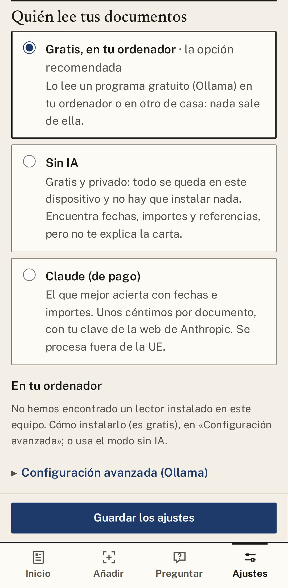
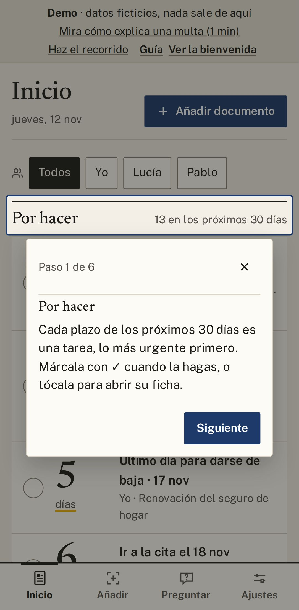

# 1. Empezar

Esto se hace una sola vez y lleva unos diez minutos: instalas Gestorín, eliges una frase secreta y
decides quién lee tus cartas. Después, solo tendrás que hacer fotos.

## Instalar

Descarga Gestorín desde la [página de descargas](https://github.com/BertMarti/gestorin/releases/latest).

**En el ordenador (Windows)**

1. Descarga el instalador de Windows y ábrelo.
2. Si Windows dice que no conoce la aplicación, pulsa **Más información → Ejecutar de todas formas**.
   Es normal: Windows aún no la conoce porque es nueva. Hazlo solo si la has bajado desde la página de descargas.
3. Si Windows no te deja de ninguna manera, usa el móvil o la demo mientras sale una versión que Windows reconozca.

**En el móvil (Android)**

1. Descarga el archivo de Android y ábrelo.
2. El móvil te pedirá permiso para instalar aplicaciones de origen desconocido: acéptalo.

## Crear tu archivo con una frase

1. La primera vez, Gestorín te pide una **frase** que solo sepas tú. Es la llave de todo lo que guardes.
2. Apúntala en papel y guárdala en un sitio seguro.

> **Importante:** si olvidas la frase, **nadie puede recuperar tus datos, ni nosotros**.

¿Ya usas Gestorín en otro aparato? Elige **Ya lo uso en otro dispositivo**.

## Elegir quién lee tus documentos

| | Cómo es | Cuesta |
|---|---|---|
| **Gratis, en tu ordenador** (recomendado) | Hay que instalar **una vez** un programa gratuito en un ordenador de casa (pide ayuda si hace falta). Desde entonces, tus cartas se leen en casa y no salen de ella. | Nada |
| **Sin inteligencia artificial** | Para quien solo tiene el móvil: saca fechas, importes y referencias en el propio móvil, sin instalar nada, pero no te explica la carta. | Nada |
| **Claude** | El que mejor acierta. La carta se envía por internet a Anthropic, la empresa de Claude, y se procesa fuera de la Unión Europea; según sus condiciones, no la usa para entrenar a su IA. Necesitas una cuenta de pago en su web. | Unos céntimos por carta |

- Si no sabes cuál elegir, deja la que Gestorín te propone. En el móvil suele ser **Sin IA**.
- Lo cambias cuando quieras en **Ajustes → Quién lee tus documentos**.
- Antes de enviar un documento fuera de casa, Gestorín **siempre te pregunta**.
- ¿Quieres el programa gratuito para toda la casa? Está explicado en [HOMELAB.md](https://github.com/BertMarti/gestorin/blob/main/docs/HOMELAB.md).

  
  &nbsp;
  

## El recorrido de bienvenida

Al terminar, Gestorín te enseña Inicio en seis pasos: pulsa **Siguiente** en cada uno. Para verlo otra
vez: **Ajustes → Ayuda y seguridad → Repetir el recorrido**.

## Dónde está cada cosa en Ajustes

De arriba abajo: **Familia**, **Avisos**, **Quién lee tus documentos**, **Copia de seguridad**, **Tu
comunidad**, **Actualizaciones** y **Ayuda y seguridad**. Al final, **Opciones avanzadas**, que casi
nunca te hará falta.

---

[← Índice](README.md) · [Anterior: Guía](README.md) · [Siguiente: Añadir un papel →](02-anadir.md)

## Modelos y su función

Claude Fable 5.2 reescribió esta guía a partir de la versión anterior; Claude Opus 5.5 hizo las capturas y la revisó.
