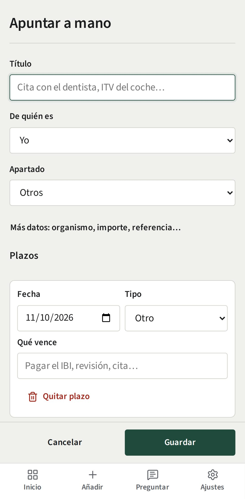

# 2. Añadir papeles

[← Índice](README.md)

Pulsa **Añadir documento** (o **Ctrl+N** en el PC). Tienes cuatro maneras:

## Con una foto

1. Pulsa **Hacer foto**. Una foto por página, con buena luz y sin cortar los bordes.
2. Gestorín encuentra la hoja y marca sus cuatro esquinas. Si no acierta, **arrástralas** hasta los
   bordes (o selecciónalas y usa las flechas del teclado).
3. Deja marcado **«Mejorar para leer»**: pasa la foto a blanco y negro con más contraste.
4. Pulsa **Recortar y añadir**. Para más páginas, **Otra página**.
5. Cuando estén todas, pulsa **Leer**.

## Con un PDF

Pulsa **Elegir archivos**, o arrastra el PDF a la ventana. Los PDF que descargas de una sede oficial
(Hacienda, DGT, Seguridad Social…) se leen muy bien, también sin IA.

> En Windows puedes elegir una **carpeta vigilada** en Ajustes (por ejemplo, Descargas). Cuando
> descargues un justificante, Gestorín te ofrecerá leerlo.

## Con un correo

¿Te llegó la multa por correo? Guarda el correo (`.eml`, o `.msg` en Outlook) y arrástralo a
Gestorín. Se leen sus adjuntos PDF y fotos; si no trae adjuntos, se lee el texto del correo. La ficha
recuerda de quién y cuándo llegó.

## Sin papel: apuntar a mano

Para una cita médica, la ITV o el IBI: **Añadir documento → Apuntar a mano**. Escribe un título, la
fecha y qué vence. Te avisaremos igual.

## Revisa siempre

La IA puede equivocarse. En cada ficha comprueba la **fecha** y el **importe** con el original
(**Ver el original**). Si algo está mal, pulsa el lápiz para corregirlo.

[← Empezar](01-empezar.md) · [Siguiente: Plazos y avisos →](03-plazos-y-avisos.md)
