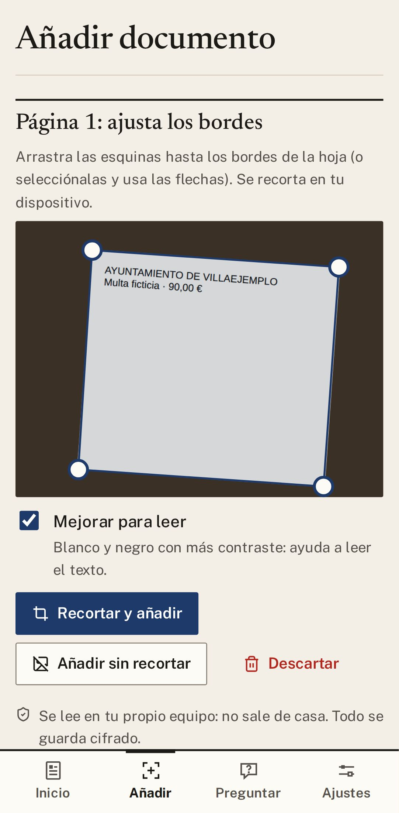
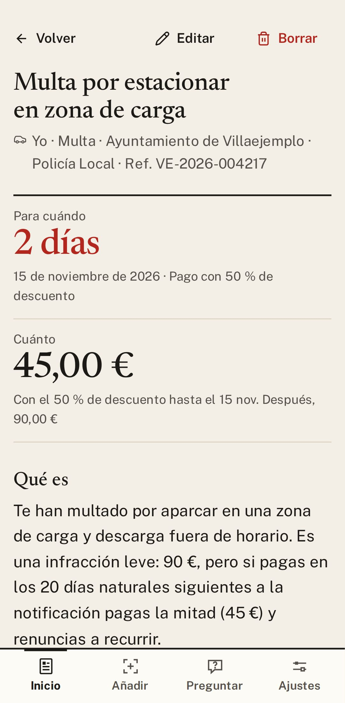
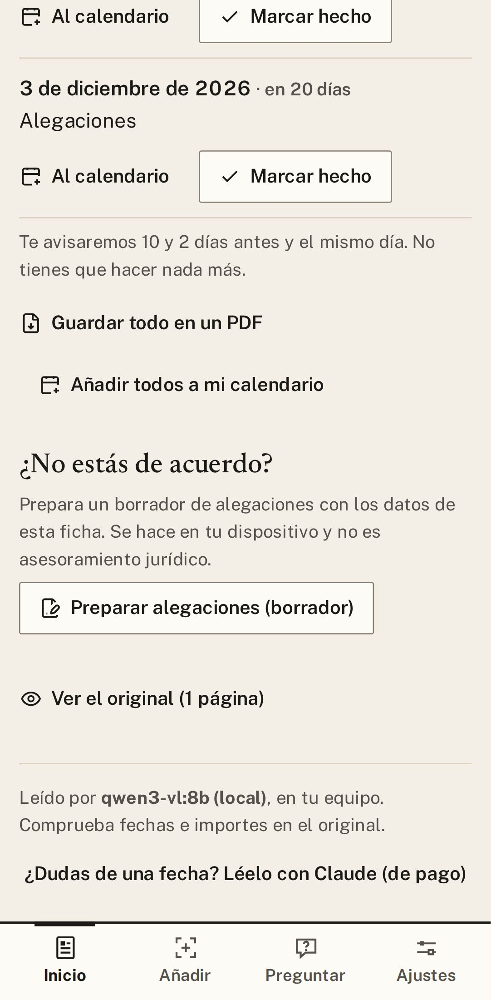

# 2. Añadir un papel y leer su ficha

Es lo que más vas a usar. Le das la carta a Gestorín (con una foto basta) y él te prepara una
**ficha**: qué es, cuánto pagas y hasta cuándo, con palabras normales.

## Con una foto

1. Pulsa **Añadir documento** y luego **Hacer foto**. Una foto por página, con buena luz y sin cortar
   los bordes. Si la foto ya la tienes, pulsa **Elegir de la galería**.
2. Gestorín encuentra la hoja y marca sus cuatro esquinas. Si no acierta, arrástralas hasta los bordes.
3. Deja marcado **Mejorar para leer** y pulsa **Recortar y añadir**.
4. ¿Tiene más páginas? Pulsa **Añadir otra página**.
5. Pulsa **Leer**. En un momento tienes la ficha.

## Otras maneras de añadir

| Tienes… | Haz esto |
|---|---|
| **Un PDF** | En el ordenador, pulsa **Elegir archivos** o arrástralo a la ventana. |
| **Un correo** | Guarda el correo (`.eml`, o `.msg` en Outlook) y arrástralo. Gestorín lee también lo que trae adjunto. |
| **Nada en papel** (una cita del médico, la ITV) | Pulsa **Apuntar a mano**, escribe un título, la fecha y qué vence, y pulsa **Guardar**. Te avisará igual. |

Las cartas en catalán, gallego o euskera también se leen: Gestorín te las explica en castellano.

## La ficha: tu carta, explicada

Arriba, en grande, **para cuándo** y **cuánto**. Debajo, **qué es** y **qué tienes que hacer**, paso a
paso. Al final, sus plazos, con una línea que te dice cuándo te avisaremos. No tienes que hacer nada más.

  
  &nbsp;
  
  &nbsp;
  

| Botón | Para qué sirve |
|---|---|
| **Marcar hecho** | Ya lo has pagado o presentado: desaparece de tus tareas. |
| **Al calendario** | Apunta ese plazo en el calendario de tu móvil o tu ordenador. |
| **Editar** | Corrige una fecha, un importe o cualquier otro dato. |
| **Ver el original** | Enseña la carta tal como la fotografiaste. |
| **Guardar todo en un PDF** | Junta la explicación, los plazos y la carta original, para imprimir o enviar a tu gestor. |

> **Compruébalo siempre.** Gestorín puede equivocarse con una fecha o un importe. Míralo en **Ver el
> original** y, si algo está mal, corrígelo con **Editar**.

Si usas Gestorín en dos aparatos y cambias la misma ficha en los dos, no se pierde nada: la ficha te
avisa y te deja ver la versión anterior (está en [Privacidad y copias](08-privacidad-y-copias.md)).

---

[← Anterior: Empezar](01-empezar.md) · [Índice](README.md) · [Siguiente: Plazos y avisos →](03-plazos-y-avisos.md)

## Modelos y su función

Claude Fable 5.2 reescribió esta guía a partir de la versión anterior; Claude Opus 5.5 hizo las capturas y la revisó.
