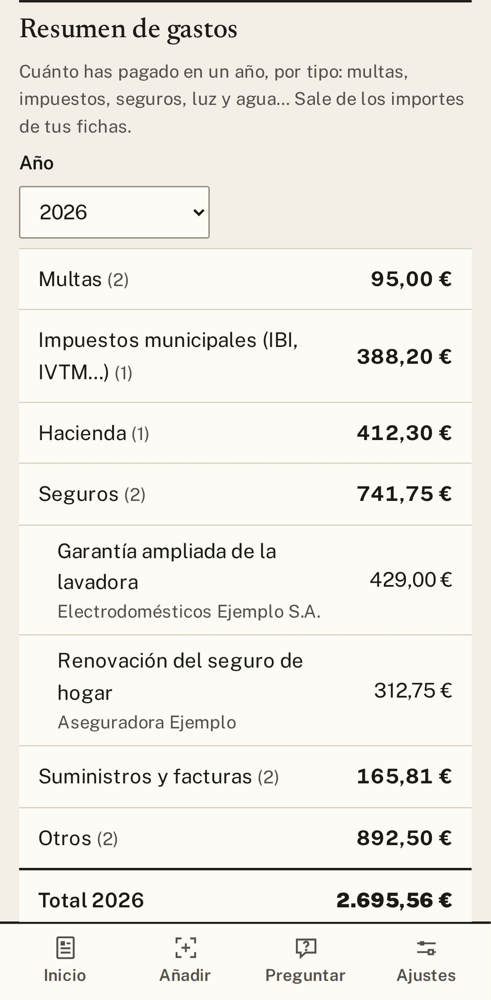

# 3. Plazos y avisos

Gestorín convierte cada plazo en una tarea y te avisa a tiempo. Tú solo miras la lista **Por hacer** y
vas marcando lo que haces. Además, te recuerda lo que toca cada año y te suma lo que llevas gastado.

## «Por hacer»: tu lista de tareas

1. Abre **Inicio**. Verás lo que vence en los próximos 30 días, **lo más urgente arriba** (en rojo, lo
   que vence ya).
2. Toca una tarea para abrir su ficha.
3. Cuando la hagas, toca el **círculo** de su izquierda. Si te equivocas, pulsa **Deshacer**.

En **Hechas** queda lo que has ido completando; desde ahí puedes **Reabrir** una tarea.

  

## Los avisos

Te avisamos **a las 9:00 de la mañana**: 7 días antes, 1 día antes y el mismo día. Algunos papeles
tienen sus propios avisos:

| Papel | Cuándo te avisa |
|---|---|
| **Multas** | Dos veces dentro del plazo con descuento y el último día. |
| **ITV** | Un mes antes, una semana antes y el mismo día. |
| **DNI y carnets** | Tres meses antes, un mes antes, una semana antes y el mismo día. |

- Para cambiarlos: **Ajustes → Avisos** y, dentro, **Avisos distintos para multas, ITV y carnets**.
- El aviso no dice de qué se trata («Vence un plazo mañana»), por si alguien ve tu móvil.
- En Android puedes poner en la pantalla del móvil el recuadro **Gestorín: próximos plazos**.

## El calendario del año

1. Entra en **Hacienda y trabajo** y baja hasta **Calendario del año**.
2. Marca lo que te toca: la **renta**, el **IBI**, el **impuesto de circulación** o la **ITV**.
3. Gestorín te avisa cada año, sin que tengas que volver a apuntarlo.

## El resumen de gastos

Debajo del calendario está **Resumen de gastos**: cuánto llevas pagado este año en seguros, impuestos,
multas, luz y agua… Elige el año y **toca un tipo para ver sus recibos**. Con **Guardar en PDF** u
**Hoja de cálculo (Excel)** te lo llevas para tu gestor.

  
  &nbsp;
  

---

[← Índice](README.md) · [Anterior: Añadir un papel](02-anadir.md) · [Siguiente: Identidad →](04-identidad.md)

## Modelos y su función

Claude Fable 5.2 reescribió esta guía a partir de la versión anterior; Claude Opus 5.5 hizo las capturas y la revisó.
