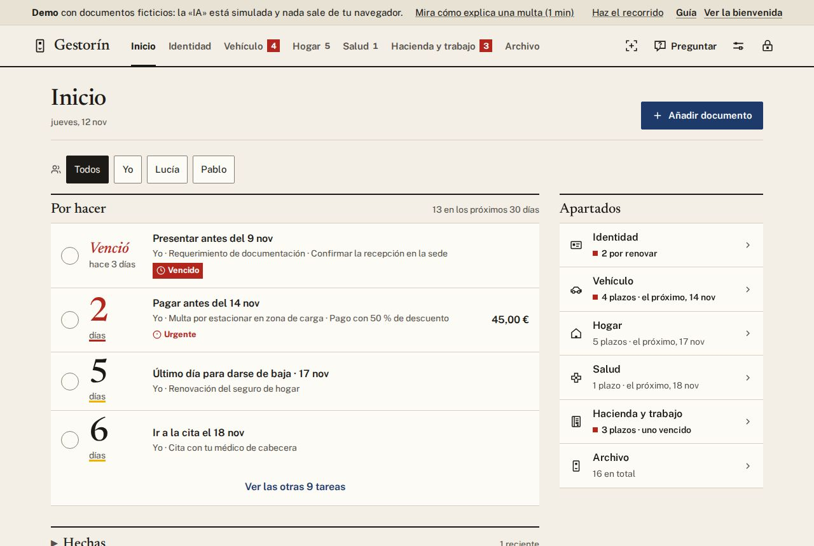
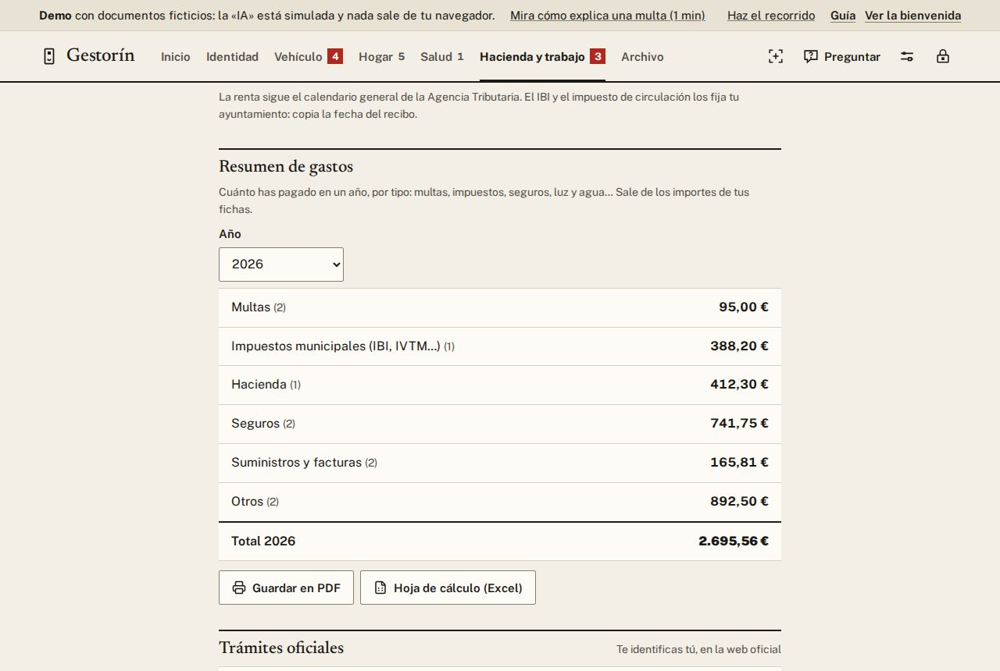
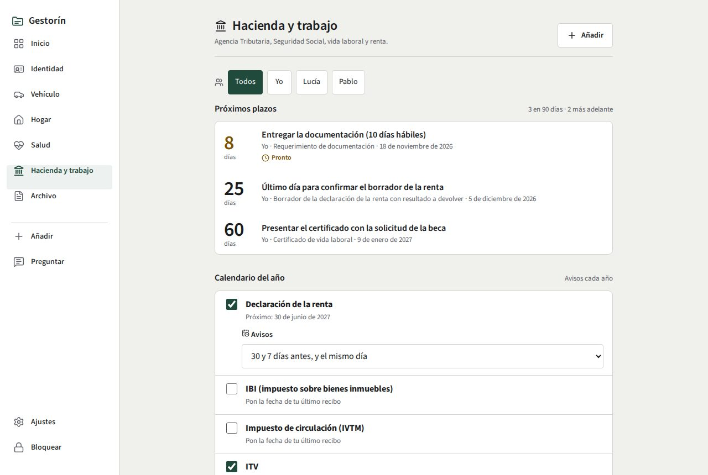

# 3. Plazos y avisos

[← Índice](README.md)

## Por hacer

En **Inicio**, la bandeja **Por hacer** convierte cada plazo de los próximos 30 días en una tarea
concreta: *«Pagar antes del 28 nov»*, *«Presentar alegación antes del…»*, *«Pedir cita ITV…»*, *«Ir a
la cita el…»*. La más urgente va primero. En rojo, lo **urgente** (3 días o menos).

- Cuando la hagas, pulsa el **✓** de su izquierda. Si te equivocas, **Deshacer** en el aviso.
- Toca la tarea para abrir su ficha.
- **Hechas** guarda lo que has ido completando y cuándo. Desde ahí puedes **Reabrir** una tarea.

En una ficha también puedes marcar cada plazo con **Marcar hecho**.

## Avisos

Gestorín te avisa **7 días antes, 1 día antes y el mismo día**, a las 9:00. Puedes cambiarlo en
**Ajustes → Avisos**.

Algunos papeles tienen sus propios avisos, que también cambias en **Ajustes → Avisos → Por tipo de
documento**:

| Tipo | Avisos de fábrica |
|---|---|
| Multas | A los días 10 y 18 de los 20 del pronto pago, y el último día |
| ITV | Un mes antes, una semana antes y el mismo día |
| DNI y carnets | Tres meses antes, uno antes, una semana antes y el mismo día |

Si un plazo concreto necesita otros días, cámbialos en su ficha: esos ganan a todo.

- Los avisos **no dicen de qué se trata** («Vence un plazo mañana»), porque se ven con el móvil
  bloqueado.
- En Windows, Gestorín vive junto al reloj y avisa aunque no lo tengas abierto.

## A tu calendario

Junto a cada plazo hay un botón de calendario: guarda un archivo `.ics` que abres con Google
Calendar, Outlook o el calendario del móvil. **Añadir todos** guarda los de la ficha.

> Los plazos de **Salud** llegan al calendario sin nada médico: solo «Plazo de salud».

## Resumen de gastos del año

En **Ajustes → Resumen de gastos**, elige el año y guarda lo que suman las fichas con importe, por
categoría: multas, impuestos municipales (IBI, impuesto de circulación…), Hacienda, Seguridad Social,
seguros, suministros y otros.

- **PDF para imprimir**: totales por categoría y el detalle de cada ficha.
- **CSV para la hoja de cálculo**: se abre directamente en Excel o LibreOffice, con las tildes y los
  céntimos bien.

Cada gasto cuenta en el año de su plazo de pago o, si no tiene, en el año en que añadiste la ficha. Son
los importes que constan en las fichas: compruébalos con tus justificantes.

## Calendario del año

En **Hacienda y trabajo → Calendario del año**, activa lo que te toca cada año: la **renta** (hasta el
30 de junio), el **IBI**, el **impuesto de circulación** y la **ITV**. Gestorín crea la ficha de cada
año y te avisa con la antelación que elijas.

## Widget en Android

Mantén pulsada la pantalla de inicio del móvil → **Widgets** → **Gestorín: próximos plazos**. Muestra
hasta tres plazos (por ejemplo, «Pago · en 2 días»), sin detalles.

[← Añadir papeles](02-anadir.md) · [Siguiente: Identidad →](04-identidad.md)
