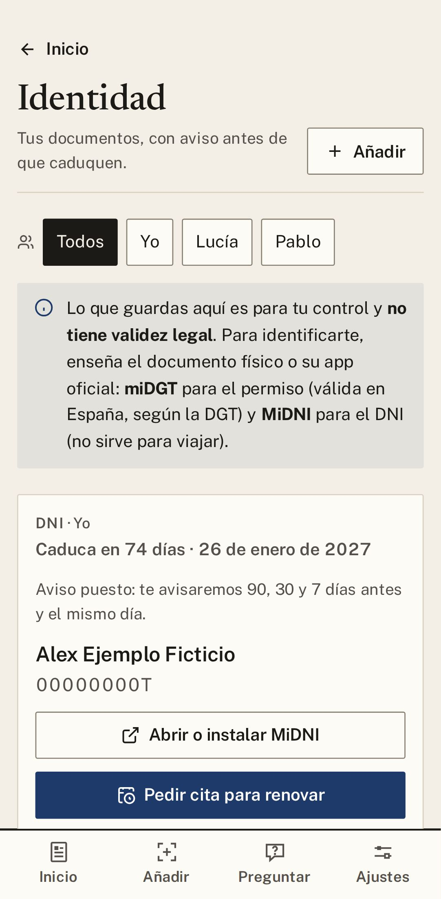

# 4. Identidad

Aquí apuntas tu DNI, el carnet de conducir, el pasaporte y la tarjeta sanitaria, con su fecha de
caducidad. Gestorín te avisa con tiempo (tres meses antes, un mes antes, una semana antes y el mismo
día) y te lleva a pedir la cita para renovarlos.

## Apuntar un carnet

1. Entra en **Identidad** y pulsa **Añadir**.
2. Elige qué carnet es y escribe su fecha de caducidad.
3. Guárdalo. Verás la línea «Aviso puesto»: ya no tienes que acordarte.

  

## Qué vale para identificarte

| | ¿Vale? |
|---|---|
| **Tu DNI o tu carnet físico** | **Sí**, siempre. |
| **La app oficial miDGT** | **Sí**, para conducir en España. Fuera de España, lleva el carnet físico. |
| **La app oficial MiDNI** | **Sí**, para identificarte en España. No sirve para viajar. |
| **Lo que guardas en Gestorín** | **No.** Es solo para tu control: no tiene validez legal. |

Gestorín abre esas apps con un toque (**Abrir o instalar MiDNI**, **Abrir o instalar miDGT**), pero no
las sustituye.

## Renovar

Cuando se acerca la fecha, aparece el botón:

- **Pedir cita para renovar** (DNI y pasaporte): te lleva a la cita oficial de la Policía Nacional. La
  cita es **gratuita**; desconfía de las webs que cobran por pedirla.
- **Cómo renovarlo** (carnet de conducir): te lleva a la web de la DGT. Lo más rápido suele ser un
  centro de reconocimiento de conductores, que lo tramita por ti.

---

[← Anterior: Plazos y avisos](03-plazos-y-avisos.md) · [Índice](README.md) · [Siguiente: Trámites y multas →](05-tramites.md)

## Modelos y su función

Claude Fable 5.2 reescribió esta guía a partir de la versión anterior; Claude Opus 5.5 hizo las capturas y la revisó.
