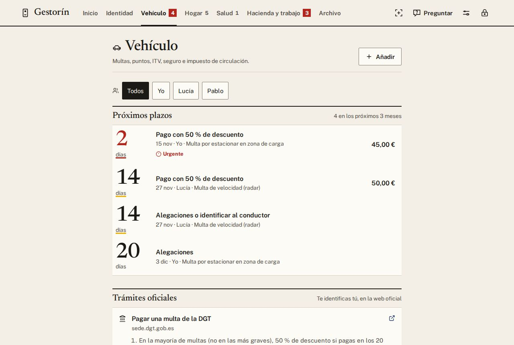
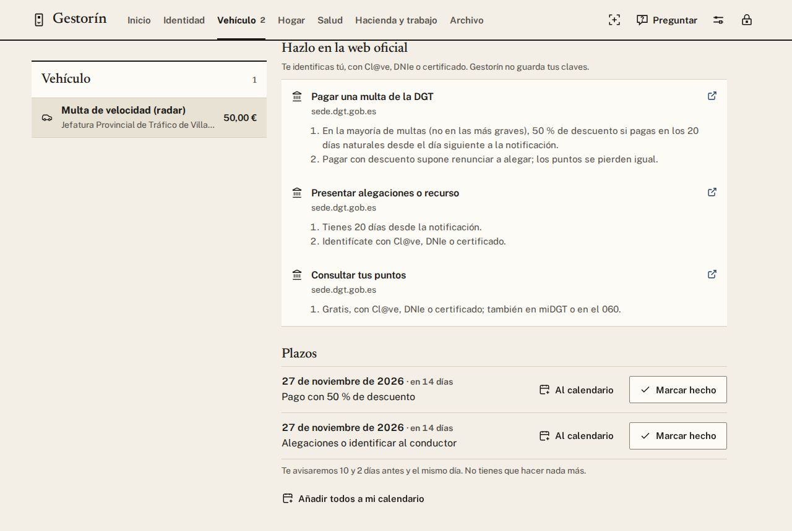
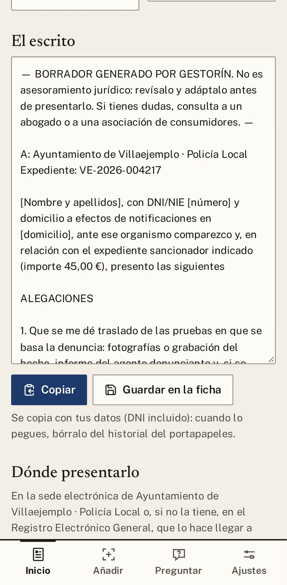

# 5. Trámites y multas

Gestorín **no entra en la DGT ni en Hacienda por ti**: te lleva a la web oficial, allí te identificas tú
y guardas el justificante. Nunca te pide tus claves. Con las multas, además, te dice si puedes pagar la
mitad y te ayuda a reclamar.

## Hacer un trámite oficial

1. Abre la ficha, o entra en su apartado (**Vehículo**, **Hacienda y trabajo**…).
2. Baja hasta **Trámites oficiales** y toca el que necesitas: pagar una multa, la renta, la vida laboral…
3. Se abre la web oficial. Identifícate tú y, al acabar, descarga el justificante y añádelo a Gestorín.

  

## Una multa: pagar o reclamar

La ficha te dice **cuánto pagas con descuento y hasta cuándo**. Tienes que elegir una de las dos:

| | Qué supone |
|---|---|
| **Pagar con descuento** | Pagas la mitad si lo haces en 20 días. A cambio, ya no puedes reclamar. |
| **Reclamar (alegaciones)** | Explicas por qué no estás de acuerdo. Pierdes el descuento. |

Si no conducías tú, tienes 20 días para decir quién conducía.

**Multas de zona azul (ORA):** en muchas ciudades se anulan el mismo día pagando poco. Gestorín te lo
recuerda en la ficha.

## Preparar las alegaciones

1. En la ficha de la multa, pulsa **Preparar alegaciones (borrador)**.
2. Marca tus motivos y escribe lo que pasó.
3. Pulsa **Usar mi DNI de Identidad** para que rellene tu nombre y tu DNI.
4. Pulsa **Copiar** o **Guardar en la ficha**, y preséntalo donde te indica, en «Dónde presentarlo».

> Es un **borrador** para que lo revises: Gestorín no es un abogado. Si dudas, consulta a uno o a una
> asociación de consumidores.

  
  &nbsp;
  

---

[← Anterior: Identidad](04-identidad.md) · [Índice](README.md) · [Siguiente: Familia →](06-familia.md)

## Modelos y su función

Claude Fable 5.2 reescribió esta guía a partir de la versión anterior; Claude Opus 5.5 hizo las capturas y la revisó.
