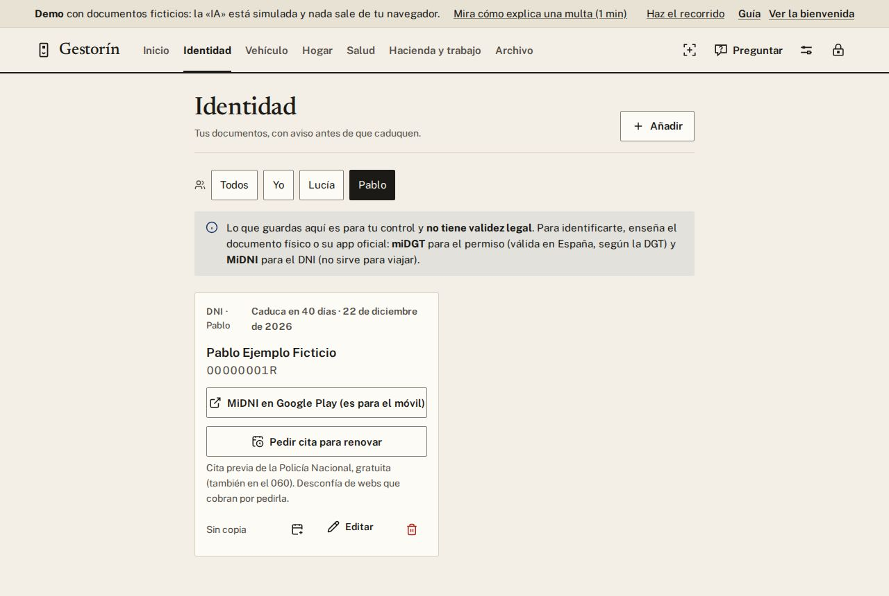
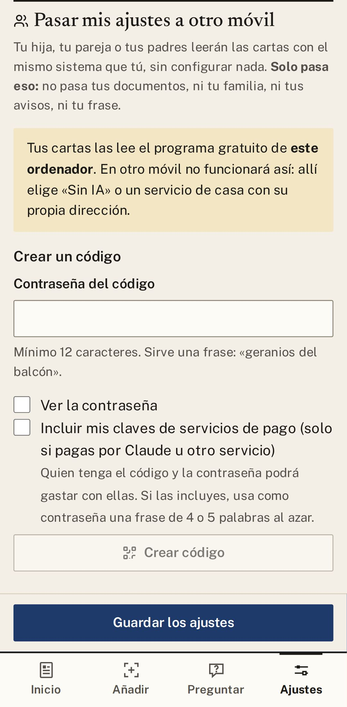

# 6. Familia

Lleva también los papeles de tu pareja, tus hijos o tus padres, y mira los de cada uno con un toque. Y
si alguien de casa también usa Gestorín, pásale tus ajustes para que no tenga que configurar nada.

## Añadir a alguien

1. Ve a **Ajustes → Familia → Añadir a alguien**, escribe su nombre y pulsa **Guardar**.
2. Arriba de cada pantalla aparecen los nombres: **Todos · Yo · Lucía · Pablo**. Toca uno para ver solo
   sus carnets y sus plazos.
3. Lo que añadas con una persona elegida queda a su nombre. Se cambia en la ficha, en **De quién es**.

Quitar a alguien **no borra sus papeles**: pasan a verse en **Todos**.

## Pasar tus ajustes a otro móvil

1. Ve a **Ajustes → Pasar mis ajustes a otro móvil**.
2. Escribe una contraseña (vale una frase, como «geranios del balcón») y pulsa **Crear código**.
3. Envíale el código con **Enviar el código**. La contraseña, dísela por teléfono o en persona.
4. La otra persona lo pega en **Usar un código que te han pasado**, escribe la contraseña y pulsa
   **Abrir el código** y después **Aplicar a mis ajustes**.

Solo pasa **la forma de leer las cartas**: nunca tus documentos, tu familia, tus avisos ni tu frase.

  
  &nbsp;
  

---

[← Índice](README.md) · [Anterior: Trámites y multas](05-tramites.md) · [Siguiente: Buscar y preguntar →](07-buscar-y-preguntar.md)

## Modelos y su función

Claude Fable 5.2 reescribió esta guía a partir de la versión anterior; Claude Opus 5.5 hizo las capturas y la revisó.
