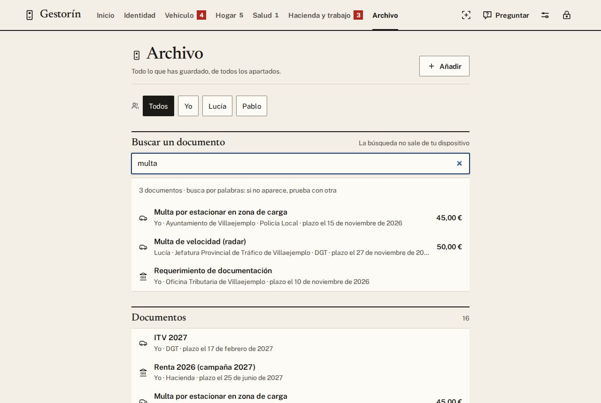
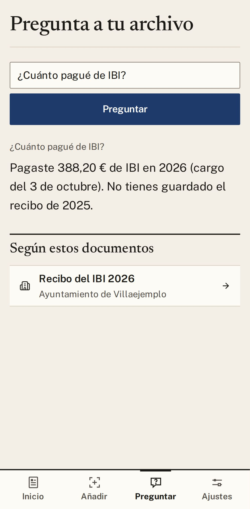
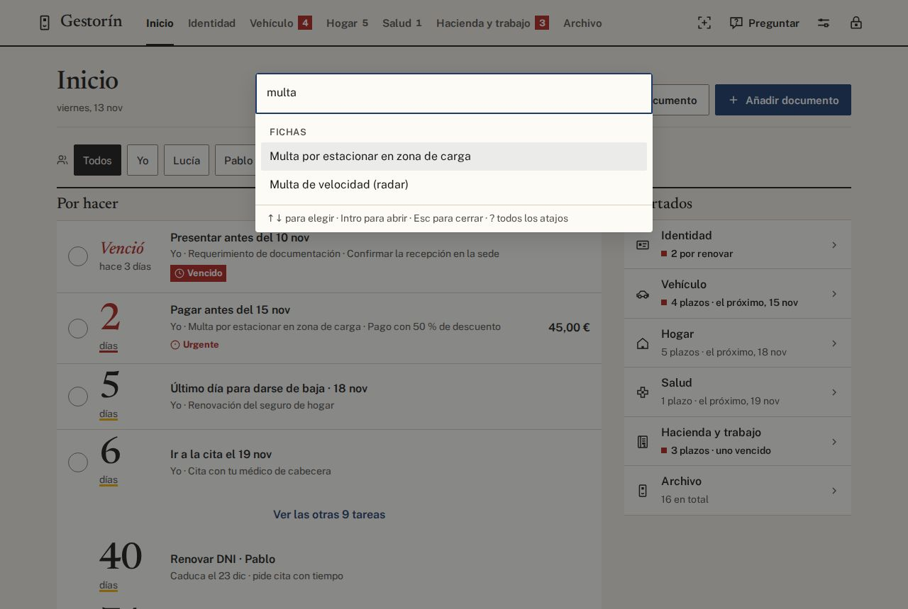

# 7. Buscar y preguntar

Todo lo que guardas se encuentra en segundos. Puedes **buscar** un papel por sus palabras o **preguntar**
como hablas, y Gestorín te contesta enseñándote en qué documento se basa.

## Buscar

1. En **Inicio**, pulsa **Buscar un documento** (en el móvil, **Buscar**).
2. Escribe una palabra: «multa», «seguro», «luz». No importan las tildes ni las mayúsculas.
3. Toca el documento para abrirlo.

Entiende también otras maneras de decirlo: «contribución» encuentra el IBI. La búsqueda nunca sale de
tu aparato.

## Preguntar

1. Pulsa **Preguntar**.
2. Escribe como hablas: «¿cuánto pagué de IBI?», «¿cuándo me toca la ITV?».
3. Lee la respuesta y, debajo, **Según estos documentos**: toca uno para comprobarlo.

Con «Sin IA», Preguntar solo contesta si tienes el programa gratuito en tu ordenador.

  
  &nbsp;
  

## Con el teclado, en el ordenador

Pulsa **Ctrl+K** y escribe lo que buscas: «añadir», «gastos», «ajustes» o el nombre de una ficha. Elige
con las flechas y pulsa **Intro**.

  

| Teclas | Qué hacen |
|---|---|
| **Ctrl+K** | Ir a cualquier sitio escribiendo |
| **Ctrl+N** | Añadir documento |
| **Ctrl+J** | Preguntar |
| **Ctrl+Z** | Deshacer lo último |
| **Ctrl+L** | Cerrar Gestorín con llave |
| **Esc** | Volver o cerrar |
| **?** | Ver todos los atajos |

Hay atajos de una sola tecla (**?**, **/**, **E**, **H**, **Supr**). Si saltan sin querer, apágalos en
**Ajustes → Ayuda y seguridad → Atajos de una sola tecla**. Los de **Ctrl** siguen funcionando.

---

[← Anterior: Familia](06-familia.md) · [Índice](README.md) · [Siguiente: Privacidad y copias →](08-privacidad-y-copias.md)

## Modelos y su función

Claude Fable 5.2 reescribió esta guía a partir de la versión anterior; Claude Opus 5.5 hizo las capturas y la revisó.
