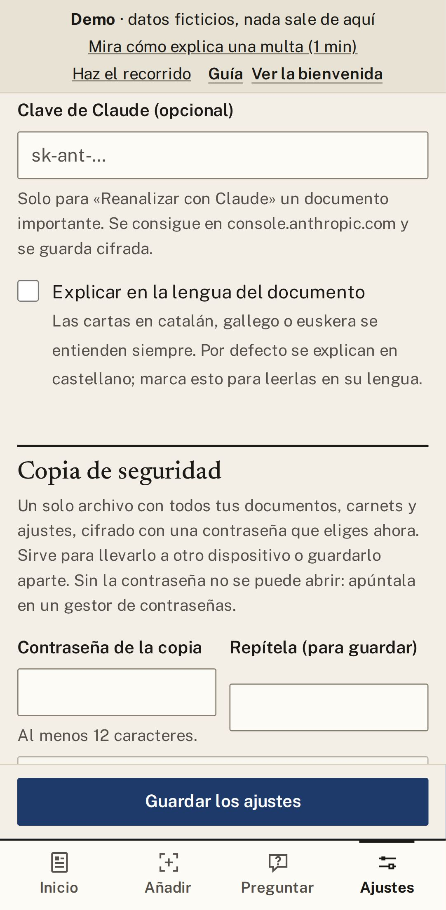
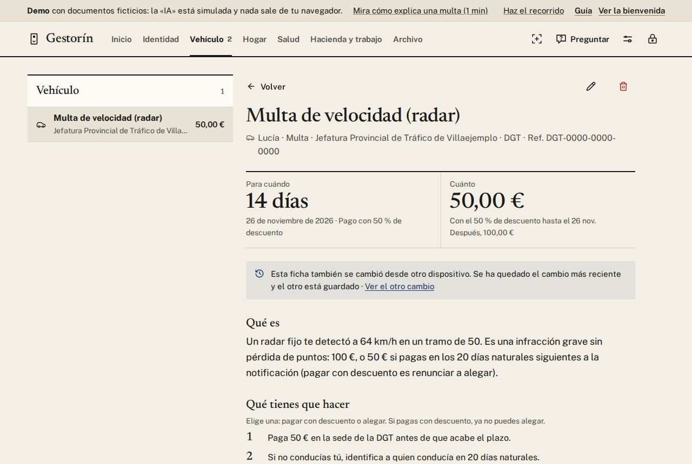

# 8. Privacidad y copias

[← Índice](README.md)

## Qué sale de tu equipo

- **Todo se guarda cifrado** con tu frase. Sin ella, nadie puede leerlo.
- **Gratis en tu equipo (Ollama)** y **Sin IA**: nada sale de casa.
- **Servicios de internet** (Gemini con tu clave de pago, Groq): Gestorín **pregunta cada vez**,
  documento a documento, antes de enviar nada. Se procesa fuera de la UE. Avisa especialmente si parece
  un informe médico o un documento de identidad. Qué permite cada uno:
  [proveedores](../legal/proveedores.md).
- **Claude** (de pago): el documento se procesa fuera de la UE. Anthropic no entrena con los datos de
  su API por defecto.
- Sin anuncios, sin analíticas, sin cuentas.

## Pasar tus ajustes a otro móvil

**Ajustes → Pasar mis ajustes a otro móvil** (justo después de Familia) crea un código, y su QR, con
quién lee tus documentos y la dirección del lector de tu casa. **Solo pasa eso:** nunca lleva tus
documentos, tu familia, tus avisos, tu frase ni la clave de sincronización. Va cifrado con una
contraseña de al menos 12 caracteres (sirve una frase, como «geranios del balcón»): dísela por
teléfono o en persona, no en el mismo mensaje. Tus claves de pago solo van si marcas «Incluir mis
claves de servicios de pago». En el móvil, **Enviar el código** lo manda por WhatsApp o correo.

Si tus cartas las lee el programa gratuito de tu ordenador («localhost»), Gestorín te avisa: en otro
móvil esa dirección no funciona.

Quien lo recibe pega el código en **Usar un código que te han pasado**, escribe la contraseña y pulsa **Abrir el código**; revisa qué trae y pulsa **Aplicar a mis
ajustes**. Hasta que pulse **Probar conexión**, la app
le pregunta antes de enviar cada documento a esa dirección. Cómo montar un Ollama para toda la casa:
[HOMELAB.md](../HOMELAB.md#ollama-para-toda-la-familia).

## Copia de seguridad

**Ajustes → Copia de seguridad**:

1. Elige una **contraseña para la copia** (al menos 12 caracteres) y repítela.
2. **Guardar copia** crea un solo archivo `.gestorin` con todo, cifrado.
3. En otro dispositivo, o tras reinstalar: crea tu archivo, ve a Ajustes, escribe la contraseña de la
   copia y pulsa **Restaurar una copia**.

> La copia trae tus documentos, carnets, familia, calendario fiscal y avisos. **No** trae el servidor
> de sincronización ni las claves de los servicios de IA: eso se configura en cada dispositivo.

## Sincronizar entre el PC y el móvil

Con tu propio servidor en casa (una Raspberry Pi, por ejemplo), Gestorín mantiene el PC y el móvil
iguales, siempre cifrado. Ver la [guía del homelab](https://github.com/BertMarti/gestorin/blob/main/docs/HOMELAB.md).

**Si cambias la misma ficha en dos dispositivos sin conexión**, se queda la última edición y la otra no
se pierde. En la ficha verás *«Esta ficha también se cambió desde otro dispositivo… · Ver el otro
cambio»*: ahí ves cómo quedaría y eliges **Usar el otro cambio** o **Quedarme con la actual**.

## Informar de un problema

Si algo falla, **Ajustes → Opciones avanzadas → Informar de un problema → Guardar informe** crea un `.zip` en tu equipo.
Lleva la versión, el sistema y los últimos errores. Antes de guardarlo se limpia de DNI, NIE, IBAN,
nombres, correos, teléfonos, claves y rutas. **No se envía a ningún sitio**: revísalo y adjúntalo tú
si quieres.

[← Buscar y preguntar](07-buscar-y-preguntar.md) · [Siguiente: Preguntas frecuentes →](09-preguntas.md)
