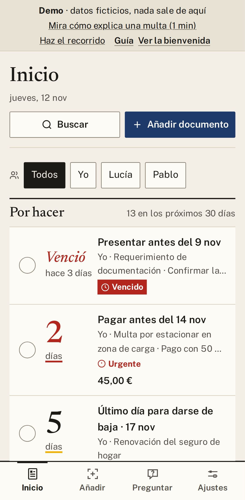

# 9. Preguntas frecuentes

Las dudas más habituales, con respuesta corta. Si la tuya no está, mira el [índice](README.md): cada
página explica una cosa, paso a paso.

  

## Dinero y datos

**¿Cuánto cuesta?**
Nada. Solo pagas si eliges Claude, y se lo pagas directamente a Anthropic: unos céntimos por carta.

**¿Mis datos van a internet?**
No, salvo que tú lo elijas. Todo se guarda cerrado en tu aparato y, si un documento tuviera que salir de
casa, te lo preguntamos antes.

**¿Funciona sin internet?**
Sí, con «Gratis, en tu ordenador» o con «Sin IA». Los avisos funcionan siempre.

**¿Y si olvido mi frase?**
Nadie puede recuperar tus datos, ni nosotros. Si tienes una copia de seguridad, crea un archivo nuevo y
pulsa **Restaurar una copia**. Por eso conviene [hacer copias](08-privacidad-y-copias.md).

## Uso

**¿Y si se equivoca con una fecha o un importe?**
Puede pasar. Abre la ficha, compruébalo en **Ver el original** y corrígelo con **Editar**. Si la carta es
importante, **¿Dudas de una fecha? Léelo con Claude (de pago)** la vuelve a leer.

**¿Gestorín paga mis multas o presenta trámites por mí?**
No. Te lleva a la web oficial y allí te identificas tú. Así nadie más tiene tus claves.

**¿Puedo enseñarle Gestorín a un agente de tráfico?**
No: lo que guardas aquí no tiene validez legal. Enséñale **miDGT** (Gestorín la abre con un toque) o tu
carnet físico.

**Uso un lector de pantalla o me manejo solo con el teclado.**
Gestorín se puede usar entero con el teclado. Los atajos están en
[Buscar y preguntar](07-buscar-y-preguntar.md).

## Instalación

**Windows dice que no conoce la aplicación.**
Windows aún no la conoce porque es nueva. Si la has bajado desde la página de descargas, pulsa **Más información → Ejecutar de todas formas**. Si lo bloquea «Smart App
Control», usa el móvil o la demo mientras sale la versión firmada.

**Tenía Gestorín en Android y la versión nueva no se instala.**
Pasa una sola vez, con versiones antiguas. Haz esto, en este orden:

1. Guarda una copia en **Ajustes → Copia de seguridad**.
2. Desinstala la versión anterior (al hacerlo se borran sus datos: por eso la copia va primero).
3. Instala la nueva y pulsa **Restaurar una copia**.

**¿Funciona en iPhone?**
Todavía no: en Windows y Android.

---

[← Índice](README.md) · [Anterior: Privacidad y copias](08-privacidad-y-copias.md)

## Modelos y su función

Claude Fable 5.2 reescribió esta guía a partir de la versión anterior; Claude Opus 5.5 hizo las capturas y la revisó.
