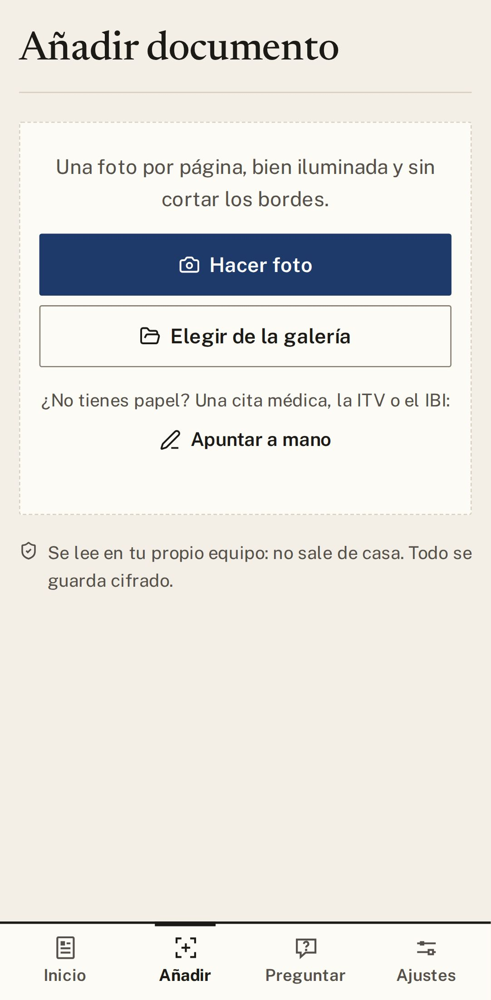
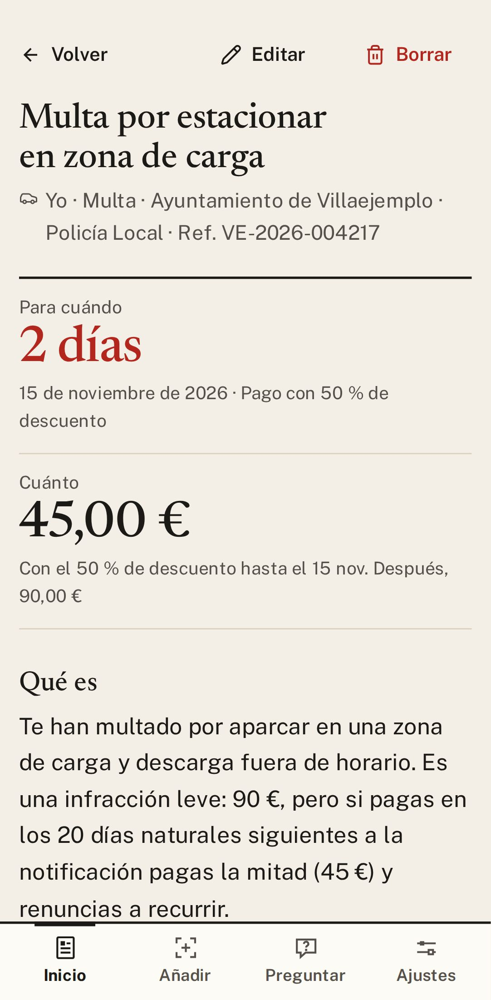
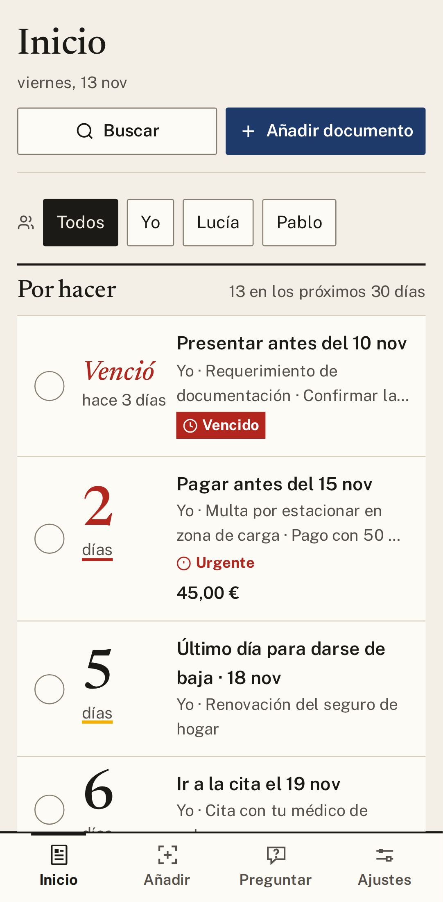

# Guía de Gestorín

**Haz una foto a una carta, una multa o una notificación, y Gestorín te dice en sencillo qué es, cuánto
pagas y hasta cuándo.** Te avisa antes de cada plazo para que no se te pase ninguno. Esta guía te lo
enseña paso a paso, con capturas y sin palabras raras.

## Así se usa, en un minuto

<table>
  <tr>
    <td width="33%" align="center"></td>
    <td width="33%" align="center"></td>
    <td width="33%" align="center"></td>
  </tr>
  <tr>
    <td align="center"><b>1. Añade la carta</b> Una foto, un PDF o un correo.</td>
    <td align="center"><b>2. Léela en sencillo</b> Qué es, cuánto y para cuándo.</td>
    <td align="center"><b>3. Lo urgente, arriba</b> Te avisa y lo marcas como hecho.</td>
  </tr>
</table>

## Índice

| Página | Qué aprendes |
|---|---|
| [1. Empezar](01-empezar.md) | Instalarlo, crear tu archivo con una frase y elegir quién lee tus cartas. |
| [2. Añadir un papel y leer su ficha](02-anadir.md) | Hacer la foto y entender la ficha: para cuándo, cuánto y qué hacer. |
| [3. Plazos y avisos](03-plazos-y-avisos.md) | La lista «Por hacer», los avisos, el calendario del año y tus gastos. |
| [4. Identidad](04-identidad.md) | Tu DNI y tus carnets, con aviso antes de que caduquen. |
| [5. Trámites y multas](05-tramites.md) | Ir a la web oficial, pagar una multa con descuento o reclamarla. |
| [6. Familia](06-familia.md) | Llevar los papeles de tu pareja, tus hijos o tus padres. |
| [7. Buscar y preguntar](07-buscar-y-preguntar.md) | Encontrar cualquier papel y preguntar como hablas. |
| [8. Privacidad y copias](08-privacidad-y-copias.md) | Quién puede ver tus datos y cómo no perderlos nunca. |
| [9. Preguntas frecuentes](09-preguntas.md) | Las dudas de siempre, en dos líneas cada una. |

## Tus apartados

| | |
|---|---|
| **Identidad** | DNI, carnet de conducir, pasaporte y tarjeta sanitaria. |
| **Vehículo** | Multas, ITV, seguro e impuesto de circulación. |
| **Hogar** | Alquiler o hipoteca, luz y agua, seguros, IBI, comunidad y garantías. |
| **Salud** | Citas, recetas e informes. |
| **Hacienda y trabajo** | Cartas de Hacienda, la renta, la vida laboral, el calendario del año y los gastos. |
| **Archivo** | Todo lo que guardas, con buscador. |

> ¿Quieres probar antes de instalar? Abre la **[demo](https://bertmarti.github.io/gestorin-demo/)**:
> usa documentos inventados y nada sale de tu navegador.

---

[Índice](README.md) · [Siguiente: Empezar →](01-empezar.md)

## Modelos y su función

Claude Fable 5.2 reescribió esta guía a partir de la versión anterior; Claude Opus 5.5 hizo las capturas y la revisó.
